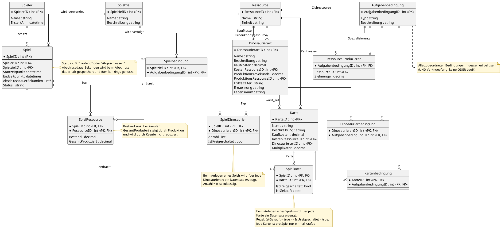
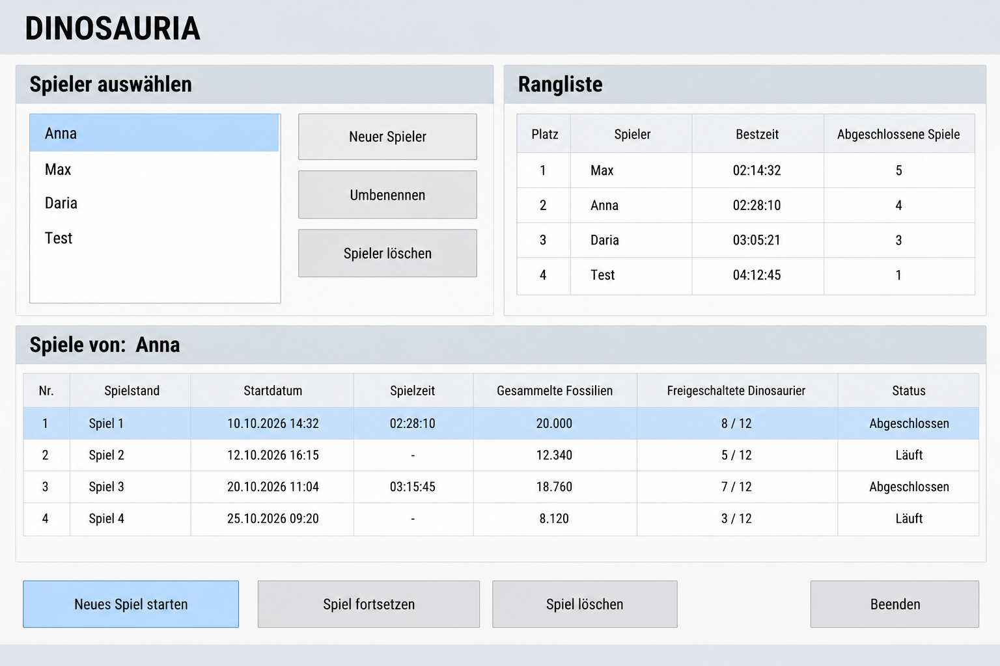
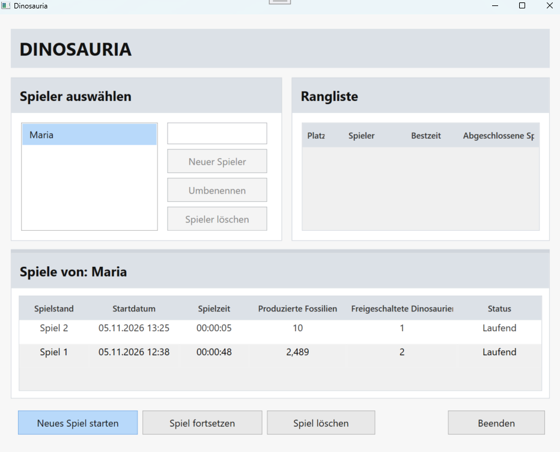
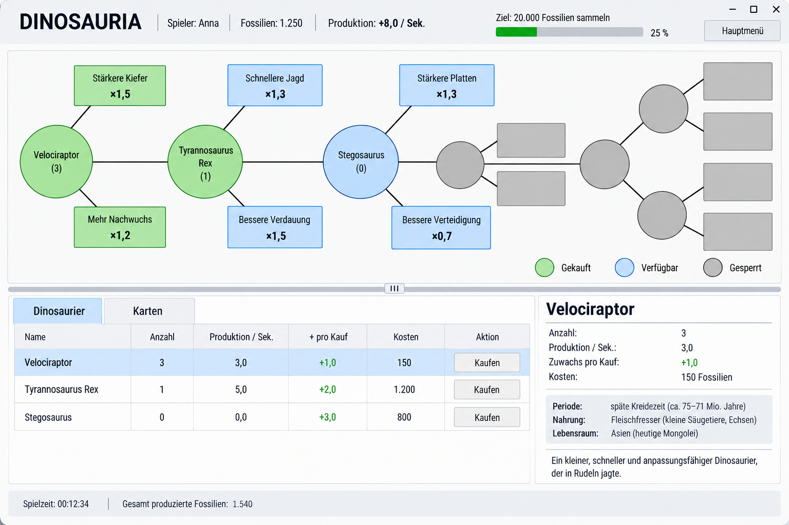
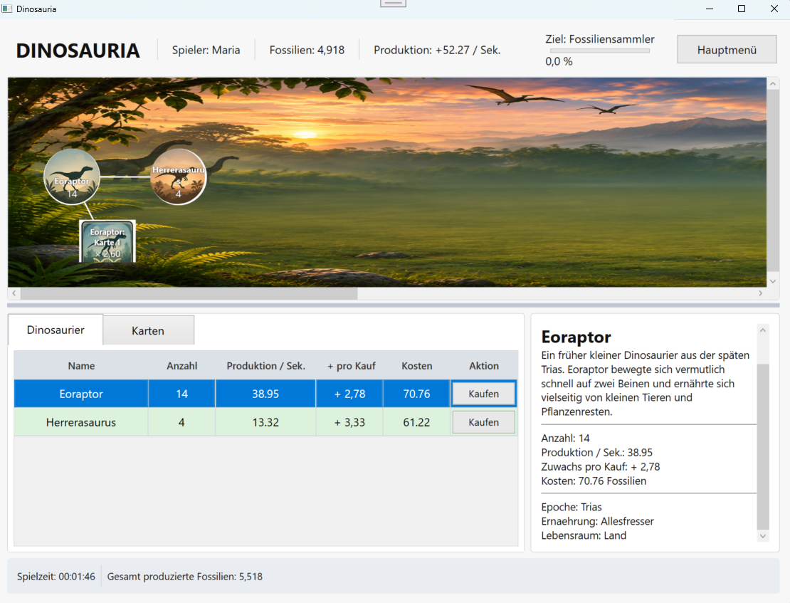
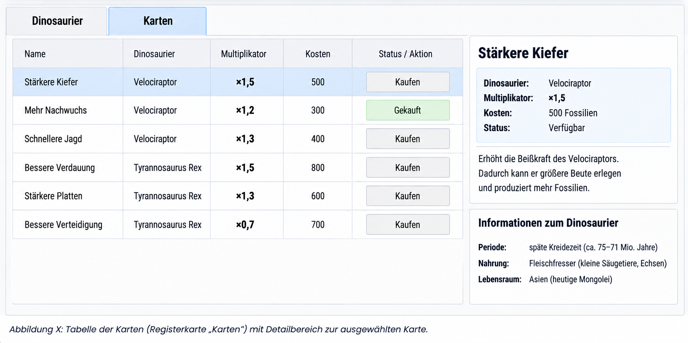
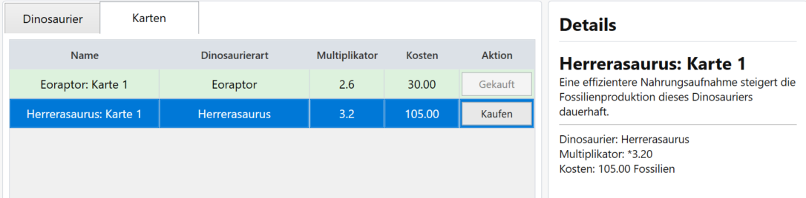

# LUTZ + GRUB ACADEMY GmbH

### Stuttgart

  

# WPF-Abschlussprojekt

## Dinosauria

  

**Projektdokumentation**

   

**Autorin:** Mariia Bashyrova

**Ausbildungsberuf:** Fachinformatikerin für Anwendungsentwicklung

**Gruppe:** FI U 25-4

  

**Abgabedatum:** 05.11.2026

# Projektdokumentation – Dinosauria

## Inhaltsverzeichnis

1.  Einleitung
2.  Anforderungen und Spielkonzept
3.  Softwarearchitektur
4.  Datenmodell
5.  Implementierung
6.  Konfiguration und CSV-Datenimport
7.  Benutzeroberfläche
8.  Tests und Qualitätssicherung
9.  Fazit und Ausblick

# 1. Einleitung

## 1.1 Projektbeschreibung

**Dinosauria** ist ein inkrementelles Aufbauspiel. Spieler erwerben
Dinosaurier, produzieren Ressourcen und schalten weitere Dinosaurier
sowie Karten frei. Ziel einer Spielrunde ist es, alle für das Spielziel
festgelegten Bedingungen zu erfüllen.

Dinosaurier fungieren als Produktionsgeneratoren. Sie erzeugen während
einer laufenden Spielrunde automatisch Ressourcen. Diese Ressourcen
werden verwendet, um weitere Dinosaurier und Karten zu erwerben. Karten
verbessern die Produktionsleistung eines bestimmten Dinosauriertyps.

Das Projekt wurde als Desktop-Anwendung mit C# und WPF umgesetzt.
Schwerpunkte sind objektorientierte Modellierung, eine Trennung der
Softwareverantwortlichkeiten und die dauerhafte Speicherung von
Spielständen.

## 1.2 Zielsetzung

Die Anwendung soll Spieler und mehrere unabhängige Spielrunden
verwalten, Dinosaurierkäufe und automatische Ressourcenproduktion
ermöglichen, Dinosaurier und Karten anhand von Bedingungen freischalten,
Spielstände speichern und fortsetzen sowie abgeschlossene Spielrunden
und Ranglisten anzeigen.

## 1.3 Spielprinzip

Zu Beginn einer Spielrunde erhält der Spieler eine konfigurierte
Startmenge einer Ressource. Ein erster Dinosauriertyp ist
freigeschaltet. Durch den Kauf von Dinosauriern wird die automatische
Ressourcenproduktion erhöht. Mit den produzierten Ressourcen können
weitere Dinosaurier und Karten erworben werden. Eine Spielrunde endet,
wenn alle Bedingungen des Spielziels erfüllt sind.

## 1.4 Technologien

  Technologie                     Verwendung
  ------------------------------- ------------------------------------------
  C#                              Programmiersprache
  .NET 9.0                 Laufzeit und Plattform
  WPF / XAML                      Grafische Desktop-Oberfläche
  Entity Framework Core 9.x 9.x       Objekt-relationaler Datenzugriff
  SQL Server LocalDB   Datenhaltung
  PlantUML                        UML- und Datenbankdiagramme
  Markdown                        Dokumentation
  xUnit                           Automatisierte Repository- und Datenbanktests

# 2. Anforderungen und Spielkonzept

## 2.1 Funktionale Anforderungen

-   Spieler ohne Passwort anlegen und vorhandene Spieler auswählen.
-   Mehrere unabhängige Spielrunden pro Spieler verwalten.
-   Neue Spielrunden starten und gespeicherte Spielrunden fortsetzen.
-   Dinosaurier mit der verfügbaren Ressource kaufen.
-   Automatische Ressourcenproduktion durch gekaufte Dinosaurier.
-   Dinosaurier und Karten anhand von Aufgabenbedingungen freischalten.
-   Freigeschaltete Karten kaufen und ihre Multiplikatoren anwenden.
-   Spielrunden beim Erreichen des Spielziels abschließen.
-   Spielzeit speichern und Ranglisten anzeigen.

## 2.2 Spielablauf

1.  Spieler auswählen oder neu anlegen.
2.  Neue Spielrunde starten oder gespeicherte Spielrunde fortsetzen.
3.  Startparameter aus der Systemkonfiguration übernehmen.
4.  Verfügbare Dinosaurier kaufen.
5.  Ressourcen automatisch produzieren.
6.  Weitere Dinosaurier und Karten durch erfüllte Bedingungen
    freischalten.
7.  Karten kaufen und Produktionsmultiplikatoren berücksichtigen.
8.  Spielziel erfüllen und Spielrunde abschließen.

## 2.3 Fachliche Regeln

-   In der ersten Version wird eine Ressource verwendet: **Fossilien**.
-   Dinosaurier erzeugen Ressourcen mit einer festgelegten
    Basisproduktionsrate.
-   Die Anzahl gekaufter Exemplare beeinflusst die Gesamtproduktion.
-   Die Kaufkosten steigen pro weiterem Exemplar. Im aktuellen Code wird
    ein Faktor von 1,15 pro bereits gekauftem Exemplar verwendet.
-   Karten sind einem bestimmten Dinosauriertyp zugeordnet.
-   Eine Karte kann pro Spielrunde nur einmal gekauft werden.
-   Die Effekte mehrerer gekaufter Karten desselben Dinosauriertyps
    werden multipliziert.
-   Bei mehreren zugeordneten Bedingungen müssen alle erfüllt sein
    (UND-Verknüpfung).
-   Implementierte Bedingungstypen: `RessourceProduzieren` und
    `DinosaurierKaufen`.
-   Ressourcenbestand und insgesamt produzierte Menge werden getrennt
    geführt. Käufe reduzieren den Bestand, nicht die
    Gesamtproduktionsmenge.
-   Offline-Produktion während das Spiel geschlossen ist, gehört nicht
    zum Umfang der ersten Version.

## 2.4 Benutzer-Storys

-   Als Spieler möchte ich einen Spieler anlegen oder auswählen, um mit
    dem Spielen zu beginnen.
-   Als Spieler möchte ich mehrere unabhängige Spielrunden starten
    können.
-   Als Spieler möchte ich Dinosaurier kaufen, damit diese Ressourcen
    produzieren.
-   Als Spieler möchte ich weitere Dinosaurier und Karten freischalten.
-   Als Spieler möchte ich Karten kaufen, um die Produktion bestimmter
    Dinosauriertypen zu erhöhen.
-   Als Spieler möchte ich einen Spielstand speichern und später
    fortsetzen.
-   Als Spieler möchte ich abgeschlossene Spielrunden vergleichen und
    eine Rangliste sehen.

# 3. Softwarearchitektur

## 3.1 Projektstruktur

| Projekt | Verantwortung |
|---|---|
| `Dinosauria.Domain` | Domänenmodelle und Repository-Schnittstellen |
| `Dinosauria.Application` | Anwendungslogik und `SpielService` |
| `Dinosauria.Infrastructure` | EF Core, Datenbankzugriff, Repository-Implementierungen und CSV-Import |
| `Dinosauria.ViewModels` | ViewModels und Präsentationslogik |
| `Dinosauria.WPF` | WPF-Views, XAML und Anwendungsstart |
| `Dinosauria.Tests` | Automatisierte Tests der Repository-Funktionen und des Datenbankzugriffs |

## 3.2 Schichtenmodell

**Domain** enthält fachliche Modelle wie `Spiel`, `Spieler`,
`Dinosaurierart`, `Karte`, `Ressource` und Aufgabenbedingungen sowie
Repository-Schnittstellen.

**Application** enthält die Anwendungslogik. Der `SpielService`
koordiniert unter anderem das Erstellen und Laden von Spielrunden,
Käufe, Ressourcenproduktion, Freischaltungen und die Prüfung des
Spielziels.

**Infrastructure** implementiert den Datenzugriff mit Entity Framework
Core. Hier befinden sich `DinosauriaDbContext`,
Repository-Implementierungen und `CsvKonfigurationLader`.

**ViewModels** vermitteln zwischen Views und Anwendungslogik. Sie
stellen Daten für die Oberfläche bereit und behandeln Benutzeraktionen.

**WPF** enthält die grafischen Ansichten und WPF-spezifische Abläufe.
Der Spieltimer wird mit `DispatcherTimer` umgesetzt.

## 3.3 MVVM

Die Anwendung verwendet das MVVM-Muster: - **Model:** fachliche Daten
und Domänenobjekte. - **View:** WPF-Oberfläche, beschrieben mit XAML. -
**ViewModel:** bereitet Daten für die View auf und stellt Aktionen
bereit.

Die View bindet ihre Darstellung an Eigenschaften und Aktionen der
ViewModels. Dadurch wird die Darstellung von der fachlichen Spiellogik
getrennt.

## 3.4 Zusammenspiel der Komponenten

Benutzeraktionen werden von der View entgegengenommen und an das
ViewModel weitergegeben. Das ViewModel verwendet den `SpielService`. Der
Service greift über Repository-Schnittstellen auf Daten zu. Die
konkreten Repository-Implementierungen verwenden den
`DinosauriaDbContext`.

# 4. Datenmodell

Das Datenmodell bildet Spieler, Spielrunden, Ressourcen, Dinosaurierarten,
Karten und Aufgabenbedingungen sowie deren Beziehungen ab. Die folgenden
Modelle zeigen die fachliche und relationale Struktur des Spiels.

## 4.1 ER-Modell

Die ER-Darstellung verwendet eine tabellenorientierte Notation mit
Crow’s-Foot-Kardinalitäten. Enumerationen wie Erdzeitalter, Ernährung und
Lebensraum werden als Attribute der Dinosaurierart modelliert.

### PlantUML-Quelltext

## 4.2 Klassendiagramm

Das Klassendiagramm beschreibt das fachliche Domänenmodell für die Umsetzung
in C# und Entity Framework Core. Es zeigt Klassen, Eigenschaften,
Navigationseigenschaften, Beziehungen, zusammengesetzte Schlüssel und
Enumerationen. Methoden sowie ViewModels, Services, Repositories und
WPF-Views sind nicht Bestandteil dieses Domänenklassendiagramms.

### PlantUML-Quelltext

```plantuml


@startuml Dinosauria_Klassendiagramm
skinparam classAttributeIconSize 0
skinparam linetype ortho
hide empty members

enum Spielstatus {
  Neu
  Laufend
  Abgeschlossen
}
enum Erdzeitalter {
  Trias
  Jura
  Kreide
}
enum Ernaehrung {
  Pflanzenfresser
  Fleischfresser
  Allesfresser
}
enum Lebensraum {
  Land
  Wasser
  Luft
}

class Spieler {
  +SpielerID : int
  +Name : string
  +ErstelltAm : DateTime
  --
  +ErstelleSpiel(spielziel : Spielziel) : Spiel
  +BerechneBesteAbschlusszeit() : TimeSpan?
  +HoleAbgeschlosseneSpiele() : List
}

class Spiel {
  +SpielID : int
  +Startzeitpunkt : DateTime
  +Endzeitpunkt : DateTime?
  +Abschlussdauer : TimeSpan?
  +Status : Spielstatus
  --
  +Starte() : void
  +Aktualisiere(deltaSekunden : decimal) : void
  +PruefeFreischaltungen() : void
  +PruefeSpielziel() : bool
  +Beende() : void
  +BerechneGesamtproduktionProSekunde() : decimal
}

class Spielziel {
  +SpielzielID : int
  +Name : string
  +Beschreibung : string
  --
  +IstErreicht(spiel : Spiel) : bool
}

class Ressource {
  +RessourceID : int
  +Name : string
  +Einheit : string
}

class SpielRessource {
  +Bestand : decimal
  +GesamtProduziert : decimal
  --
  +ErhoeheBestand(menge : decimal) : void
  +Verbrauche(menge : decimal) : bool
  +BucheProduktion(menge : decimal) : void
}

class Dinosaurierart {
  +DinosaurierartID : int
  +Name : string
  +Beschreibung : string
  +Kaufkosten : decimal
  +ProduktionProSekunde : decimal
  +Erdzeitalter : Erdzeitalter
  +Ernaehrung : Ernaehrung
  +Lebensraum : Lebensraum
  --
  +BerechneProduktion(anzahl : int, multiplikator : decimal) : decimal
}

class SpielDinosaurier {
  +Anzahl : int
  +IstFreigeschaltet : bool
  --
  +KannGekauftWerden() : bool
  +Kaufe() : bool
  +BerechneProduktionProSekunde() : decimal
}

class Karte {
  +KarteID : int
  +Name : string
  +Beschreibung : string
  +Kaufkosten : decimal
  +Multiplikator : decimal
  --
  +BerechneMultiplikator() : decimal
}

class Spielkarte {
  +IstFreigeschaltet : bool
  +IstGekauft : bool
  --
  +KannGekauftWerden() : bool
  +Kaufe() : bool
}

abstract class Aufgabenbedingung {
  +AufgabenbedingungID : int
  +Beschreibung : string
  --
  {abstract} +IstErfuellt(spiel : Spiel) : bool
}

class RessourceProduzieren {
  +Zielmenge : decimal
  --
  +IstErfuellt(spiel : Spiel) : bool
}

class DinosaurierKaufen {
  +Anzahl : int
  --
  +IstErfuellt(spiel : Spiel) : bool
}

class Spielbedingung {
  +SpielzielID : int
  +AufgabenbedingungID : int
  
  +Spielziel : Spielziel
  +Aufgabenbedingung : Aufgabenbedingung
  --
}

class Dinosaurierbedingung {
  +DinosaurierartID : int
  +AufgabenbedingungID : int
  
  +Dinosaurierart : Dinosaurierart
  +Aufgabenbedingung : Aufgabenbedingung
  --
}

class Kartenbedingung {
  +KarteID : int
  +AufgabenbedingungID : int
  
  +Karte : Karte
  +Aufgabenbedingung : Aufgabenbedingung
  --
}

Spieler "1" -- "0..*" Spiel : besitzt
Spielziel "1" -- "0..*" Spiel : wird_verwendet
Spiel "1" *-- "0..*" SpielRessource : hat
Ressource "1" -- "0..*" SpielRessource : Ressourcentyp
Spiel "1" *-- "0..*" SpielDinosaurier : enthaelt
Dinosaurierart "1" -- "0..*" SpielDinosaurier : Typ
Ressource "1" -- "0..*" Dinosaurierart : Kaufressource
Ressource "1" -- "0..*" Dinosaurierart : Produktionsressource
Spiel "1" *-- "0..*" SpielKarte : enthaelt
Karte "1" -- "0..*" SpielKarte : Kartenstatus
Ressource "1" -- "0..*" Karte : Kaufressource
Dinosaurierart "1" -- "0..*" Karte : wirkt_auf
Aufgabenbedingung <|-- RessourceProduzieren
Aufgabenbedingung <|-- DinosaurierKaufen
Ressource "1" -- "0..*" RessourceProduzieren : Zielressource
Dinosaurierart "1" -- "0..*" DinosaurierKaufen : Zieldino
Spielziel "1" -- "0..*" Spielbedingung
Aufgabenbedingung "1" -- "0..*" Spielbedingung
Dinosaurierart "1" -- "0..*" Dinosaurierbedingung
Aufgabenbedingung "1" -- "0..*" Dinosaurierbedingung
Karte "1" -- "0..*" Kartenbedingung
Aufgabenbedingung "1" -- "0..*" Kartenbedingung
Dinosaurierart ..> Erdzeitalter
Dinosaurierart ..> Ernaehrung
Dinosaurierart ..> Lebensraum

@enduml


```

## 4.3 Zentrale Modellentscheidungen

- `SpielRessource` speichert den aktuellen Bestand und die insgesamt produzierte Menge getrennt.
- `SpielDinosaurier` speichert pro Spiel und Dinosaurierart Anzahl und Freischaltungsstatus.
- `Spielkarte` speichert pro Spiel und Karte den Freischaltungs- und Kaufstatus. Eine Karte kann pro Spiel nur einmal gekauft werden.
- `Aufgabenbedingung` ist die abstrakte Grundlage konkreter Bedingungstypen. Implementiert sind `RessourceProduzieren` und `DinosaurierKaufen`.
- Die Zuordnungstabellen verwenden zusammengesetzte Schlüssel, soweit dies im Modell vorgesehen ist.

## 4.4 Datenbank und Persistenz

Die Anwendung verwendet Entity Framework Core 9.x für den objekt-relationalen
Zugriff auf SQL Server LocalDB. Spielstände und zugehörige Daten werden
dauerhaft in der Datenbank gespeichert.

# 5. Implementierung

## 5.1 Erstellen und Laden einer Spielrunde

Beim Erstellen einer Spielrunde werden Spieler, Spielziel und
Startressource festgelegt. Die Startparameter stammen aus
`SystemKonfiguration`. Für die Spielrunde werden Spielressourcen,
Dinosaurier und Karten initialisiert. Beim Fortsetzen wird der
gespeicherte Spielstand anhand der Spiel-ID geladen und die gespeicherte
Spielzeit wiederhergestellt.

## 5.2 Ressourcenproduktion

Während einer laufenden Spielrunde aktualisiert ein `DispatcherTimer`
regelmäßig die Produktion. Die seit dem letzten Update vergangene Zeit
wird an das ViewModel übergeben. Die Produktionsmenge wird anhand der
Produktionsrate und der vergangenen Zeit berechnet und sowohl dem
Bestand als auch der Gesamtproduktionsmenge hinzugefügt.

## 5.3 Kauf von Dinosauriern

Ein Dinosaurier kann gekauft werden, wenn er freigeschaltet ist und
genügend Ressourcen vorhanden sind. Die Kosten werden anhand der
Basis-Kaufkosten und der bereits vorhandenen Anzahl berechnet. Der Kauf
reduziert den Bestand und erhöht die Anzahl des Spiel-Dinosauriers.

## 5.4 Karten und Multiplikatoren

Eine Karte kann gekauft werden, wenn sie freigeschaltet, noch nicht
gekauft und ausreichend Ressourcen vorhanden sind. Ihr Multiplikator
beeinflusst die Produktion des zugehörigen Dinosauriertyps. Mehrere
gekaufte Kartenmultiplikatoren werden miteinander multipliziert.

## 5.5 Freischaltungssystem

Der `SpielService` prüft die Aufgabenbedingungen. Sind alle einem
Dinosaurier oder einer Karte zugeordneten Bedingungen erfüllt, wird das
jeweilige Spielelement freigeschaltet.

## 5.6 Spielziel und Spielabschluss

Das Spielziel ist erreicht, wenn alle ihm zugeordneten
Aufgabenbedingungen erfüllt sind. Beim Abschluss werden Spielstatus,
Endzeitpunkt und benötigte Spieldauer gespeichert.

## 5.7 Spielzeit und Wiederaufnahme

Die Spielzeit wird während einer laufenden Runde gemessen und
gespeichert. Beim Fortsetzen einer vorhandenen Spielrunde wird die
gespeicherte Dauer als Ausgangswert für die weitere Zeitmessung
verwendet.

## 5.8 Ranglisten

Abgeschlossene Spielrunden werden anhand ihrer Abschlussdauer
ausgewertet. Die Spielerrangliste ordnet Spieler nach ihrer jeweils
besten (kürzesten) abgeschlossenen Spielzeit. Eigene Spielrunden können
ebenfalls angezeigt und sortiert werden.

## 5.9 Fehlerbehandlung

Nicht vorhandene Spieler, Spiele oder Spielelemente führen an den
entsprechenden Stellen zu Ausnahmen. Eingaben werden geprüft.

# 6. Konfiguration und CSV-Datenimport

Die Ausgangsdaten und die Startkonfiguration des Spiels werden aus CSV-Dateien
eingelesen und in der Datenbank gespeichert. Die Dateien dienen der initialen
Bereitstellung der Spieldaten.

# 7. Benutzeroberfläche

## 7.1 Aufbau

Die Benutzeroberfläche wurde mit WPF umgesetzt. Die Ansichten sind in XAML definiert. Die ViewModels stellen die benötigten Daten und Aktionen für die Views bereit.

## 7.2 Hauptmenü und Spielerauswahl

Im Hauptmenü wird der gewünschte Spieler ausgewählt. Außerdem können Spieler verwaltet, gespeicherte Spielrunden geöffnet und die Rangliste aufgerufen werden. Von hier aus kann eine neue Spielrunde gestartet oder eine vorhandene fortgesetzt werden.

Der ursprüngliche Wireframe zeigte bereits die grundlegende Anordnung der Bereiche. In der fertigen Anwendung wurde dieser Entwurf umgesetzt und um die konkrete Darstellung der Spielerauswahl und der verfügbaren Aktionen ergänzt.

**Wireframe:**

**Fertige Anwendung:**

### 7.2.1 Spieler auswählen und verwalten

- Eine Liste zeigt alle vorhandenen Spieler.
- Über **„Neuer Spieler“** kann ein neuer Spieler angelegt werden.
- **„Umbenennen“** ändert den Namen des ausgewählten Spielers.
- **„Spieler löschen“** entfernt den ausgewählten Spieler nach einer Bestätigung einschließlich seiner gespeicherten Spiele.

### 7.2.2 Rangliste

Die globale Rangliste zeigt pro Spieler die beste Abschlusszeit und die Anzahl der abgeschlossenen Spiele. Maßgeblich ist die kürzeste Zeit, in der der Spieler das Spielziel erreicht hat. Spieler ohne abgeschlossene Spiele werden nicht in die Rangliste aufgenommen.

### 7.2.3 Spiele des ausgewählten Spielers

Die Tabelle zeigt die gespeicherten Spiele des oben ausgewählten Spielers. Angezeigt werden Spielnummer, Startdatum, Spielzeit, Gesamtproduktion der Fossilien, freigeschaltete Dinosaurier und Status. Laufende Spiele können fortgesetzt werden; abgeschlossene Spiele dienen der Ergebnisansicht.

Die Schaltflächen im unteren Bereich ermöglichen das Starten eines neuen Spiels, das Fortsetzen des ausgewählten laufenden Spiels, das Löschen eines ausgewählten Spielstands und das Beenden der Anwendung.

## 7.3 Spielansicht

Die Spielansicht zeigt den aktuellen Spielstand und den Fortschritt in Richtung des Spielziels. Auf dem Spielfeld werden die freigeschalteten Dinosaurier und Karten grafisch dargestellt. Dinosaurier erscheinen als runde Elemente, Karten als rechteckige Elemente. Bilder, Bezeichnungen und Verbindungen machen die Beziehungen zwischen den freigeschalteten Elementen sichtbar.

Die Tabelle unterhalb des Spielfelds enthält die spielrelevanten Informationen zu den Dinosaurierarten, darunter Anzahl, aktuelle Produktion, Produktionssteigerung und Kosten des nächsten Kaufs.

Der Wireframe legte die Grundstruktur aus Spielfeld und darunterliegender Tabelle fest. In der fertigen Anwendung wurde diese Struktur übernommen und mit den tatsächlichen Spielelementen und Daten umgesetzt.

**Wireframe:**

**Fertige Anwendung:**

### 7.3.1 Kopfzeile und Spielziel

- Die Kopfzeile zeigt den Spielnamen, den Spielernamen, den aktuellen Fossilienbestand und die Produktion pro Sekunde.
- Das Spielziel und der Fortschritt werden im oberen Bereich angezeigt.
- Die Schaltfläche **„Hauptmenü“** führt zurück zum Hauptmenü.

### 7.3.2 Spielfeld

- Das Spielfeld ist eine gemeinsame, bei Bedarf scrollbar ausgeführte Fläche.
- Dinosaurier werden als Kreise und Karten als Rechtecke dargestellt. Es werden zunächst nur einfache geometrische Formen, Text und gerade Verbindungslinien verwendet.
- Jede Karte ist genau einer Dinosaurierart zugeordnet und wird durch eine direkte Linie mit dem zugehörigen Dinosaurier-Kreis verbunden. 

### 7.3.3 Dinosaurier-Tabelle

Unterhalb des Spielfelds befindet sich eine Tabelle mit allen freigeschalteten Dinosaurierarten, die bereits gekauft wurden oder zum Kauf verfügbar sind. Gesperrte Arten werden nicht angezeigt.

Die Tabelle enthält folgende Spalten: **Name**, **Anzahl**, **Produktion pro Sekunde**, **Produktionszuwachs beim Kauf eines weiteren Exemplars**, **Kosten des nächsten Exemplars** und die Schaltfläche **„Kaufen“**.

Die angezeigte Produktion berücksichtigt bereits alle aktiven Kartenmultiplikatoren. Bei einer freigeschalteten, aber noch nicht gekauften Dinosaurierart beträgt die aktuelle Produktion null. Der angezeigte Produktionszuwachs berücksichtigt ebenfalls die aktiven Kartenmultiplikatoren. Der Preis jedes weiteren Exemplars steigt um 15 % gegenüber dem Preis des vorherigen Exemplars.

Rechts neben der Tabelle befindet sich ein Detailbereich, in dem zusätzliche Informationen zum ausgewählten Dinosaurier angezeigt werden: Name, Anzahl, Produktion pro Sekunde, Produktionszuwachs beim Kauf, Kosten des nächsten Exemplars sowie Erdzeitalter, Ernährung, Lebensraum und eine kurze Beschreibung.

### 7.3.5 Statuszeile

Am unteren Rand werden die bisherige Spielzeit und die insgesamt produzierten Fossilien angezeigt. Die Gesamtproduktion ist ein kumulierter Wert und wird durch Käufe nicht reduziert.

## 7.4 Kartenübersicht

Die Karten werden in einer separaten Tabellenansicht angezeigt. Dort sind unter anderem die zugehörige Dinosaurierart, der Multiplikator und die Kosten einer Karte ersichtlich. Ein Detailbereich zeigt zusätzliche Informationen zur ausgewählten Karte.

Der Entwurf der Kartenübersicht diente als Vorlage für die Anordnung der Tabelle und des Detailbereichs. Die fertige Ansicht übernimmt dieses Grundkonzept und zeigt die Karten mit den Daten der Anwendung.

**Entwurf:**

**Fertige Anwendung:**

Die Tabelle enthält folgende Spalten: **Name**, **zugehörige Dinosaurierart**, **Multiplikator**, **Kosten** und **Aktion**. Bereits gekaufte Karten sind entsprechend gekennzeichnet und können nicht erneut gekauft werden. Für verfügbare Karten wird die Schaltfläche **„Kaufen“** angezeigt. Ist das Fossilienguthaben nicht ausreichend, ist die Kaufaktion nicht verfügbar.

Rechts neben der Tabelle befindet sich ein Detailbereich für die ausgewählte Karte. Er zeigt den Namen, die zugehörige Dinosaurierart, den Multiplikator, die Kosten, den Freischaltungs- bzw. Kaufstatus und eine kurze Beschreibung an. Zusätzlich werden Informationen zur zugehörigen Dinosaurierart angezeigt: Erdzeitalter, Ernährung und Lebensraum.

Nach dem Kauf  die Produktion der zugehörigen Dinosaurierart und die Gesamtproduktion automatisch aktualisiert.

# 8. Tests und Qualitätssicherung

## 8.1 Manuelle Funktionstests

Die Anwendung wurde während der Entwicklung wiederholt ausgeführt und
die Funktionen praktisch überprüft. Zu den relevanten Abläufen gehören
Spieleranlage, Start und Fortsetzung einer Spielrunde, Käufe,
Ressourcenproduktion, Freischaltungen, Kartenmultiplikatoren,
Spielabschluss sowie Speicherung und Wiederherstellung der Spielzeit.

## 8.2 Automatisierte Tests

Das separate Testprojekt `Dinosauria.Tests` verwendet xUnit. Die
automatisierten Tests überprüfen die Repository-Funktionen und den
Datenbankzugriff. Dabei wird insbesondere geprüft, ob die Datenbank-
operationen fehlerfrei ausgeführt und Datensätze korrekt gespeichert
werden.

## 8.3 Qualitätssicherung

Fehler wurden während der Entwicklung durch wiederholte Ausführung,
Debugging und Überprüfung der Datenbankzustände untersucht und behoben.

# 9. Fazit und Ausblick

## 9.1 Projektergebnis

Mit Dinosauria wurde eine spielbare WPF-Desktop-Anwendung entwickelt.
Sie verbindet objektorientierte Domänenmodelle, eine mehrschichtige
Softwarestruktur, MVVM und die persistente Speicherung mit Entity
Framework Core.

Die zentralen Spielmechaniken -- Ressourcenproduktion, Dinosaurierkäufe,
Freischaltung über Aufgabenbedingungen, Karten mit
Produktionsmultiplikatoren sowie Speichern und Fortsetzen von
Spielrunden -- sind umgesetzt.

## 9.2 Bekannte Einschränkungen

Die erste Version verwendet eine Ressource und eine zentrale
Startkonfiguration. Eine Administrationsoberfläche und die Verwaltung
mehrerer unterschiedlicher Konfigurationen sind nicht Bestandteil der
aktuellen Umsetzung. Eine Ressourcenproduktion während das Spiel
geschlossen ist, ist ebenfalls nicht vorgesehen.

## 9.3 Mögliche Erweiterungen

-   Administrationsoberfläche zur Pflege der Spieldaten;
-   Unterstützung weiterer Ressourcen;
-   Verwaltung unterschiedlicher Spielkonfigurationen;
-   zusätzliche Spielziele und Bedingungstypen;
-   weitere Spielereignisse und Spielmechaniken;
-   Überarbeitung und Erweiterung der Spielbalance.

