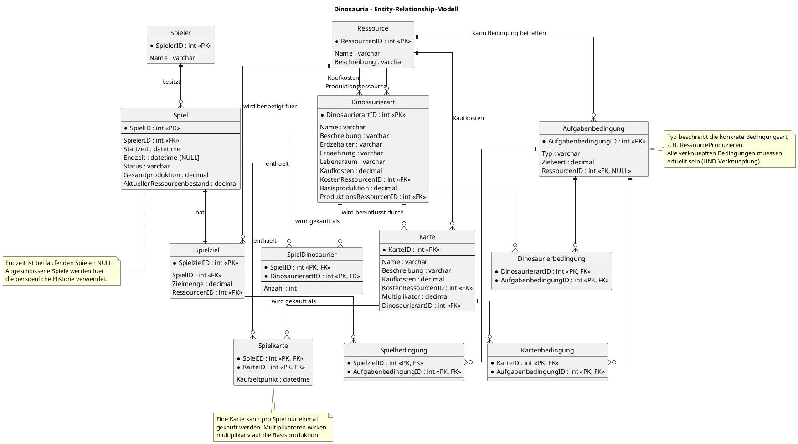

# Dinosauria – ER-Modell

## 1. Zweck

Das ER-Modell beschreibt die relationalen Daten, die für die erste Version von **Dinosauria** benötigt werden. Es berücksichtigt Spieler, mehrere Spielstände pro Spieler, Dinosaurier und Karten, Ressourcen, Freischaltbedingungen, Spielziele sowie abgeschlossene Spiele und Ranglisten.

Die Darstellung verwendet PlantUML mit der Chen-ähnlichen Entity-Relationship-Notation. Primärschlüssel sind mit `PK`, Fremdschlüssel mit `FK` gekennzeichnet.

## 2. ER-Diagramm

## 3. Wichtige Modellierungsentscheidungen

- **Spieler und Spiel:** Ein Spieler kann mehrere unabhängige Spiele speichern. Jedes Spiel gehört genau einem Spieler.
- **Spielziel:** Für Version 1 hat jedes Spiel genau ein Ziel. Das Ziel zählt die insgesamt produzierte Menge einer Ressource, nicht nur den aktuellen Bestand.
- **Ressourcen:** Das Modell unterstützt mehrere Ressourcen, obwohl Version 1 zunächst nur eine Ressource verwendet.
- **Dinosaurier:** `Dinosaurierart` beschreibt den gemeinsamen Katalog. `SpielDinosaurier` speichert den Besitz und die Anzahl pro Spiel.
- **Karten:** `Karte` beschreibt den Kartenkatalog. `Spielkarte` speichert gekaufte Karten pro Spiel. Der zusammengesetzte Schlüssel verhindert, dass dieselbe Karte innerhalb eines Spiels mehrfach gekauft wird.
- **Kartenwirkung:** Jede Karte beeinflusst in Version 1 eine Dinosaurierart. Mehrere Kartenmultiplikatoren werden miteinander multipliziert.
- **Aufgabenbedingungen:** `Aufgabenbedingung` ist eine gemeinsame abstrakte fachliche Idee. Die Zuordnungstabellen `Spielbedingung`, `Dinosaurierbedingung` und `Kartenbedingung` verbinden Bedingungen mit Spielzielen beziehungsweise Freischaltobjekten. Alle zugeordneten Bedingungen müssen erfüllt sein.
- **Rangliste:** Eine eigene Ranglisten-Tabelle ist nicht erforderlich. Sie kann aus abgeschlossenen Spielen abgeleitet werden: persönliche Bestzeit je Spieler und anschließend globale Sortierung nach der kürzesten Zeit.
- **Admin-Funktionen:** Sie sind nicht Teil von Version 1 und werden daher hier nicht modelliert.

## 4. Hinweise zur Umsetzung

Das Diagramm ist ein fachlicher Entwurf und noch kein endgültiges Datenbankschema. Vor der Implementierung sollten insbesondere folgende Punkte geprüft werden:

1. Ob `Status` als Text oder als festgelegter Wertebereich modelliert wird.
2. Ob `Gesamtproduktion` und `AktuellerRessourcenbestand` in Version 1 als getrennte Werte gespeichert oder teilweise aus Ereignissen berechnet werden.
3. Ob Bedingungen künftig unterschiedliche Daten benötigen. Falls ja, kann die gemeinsame Tabelle um typabhängige Detailtabellen ergänzt werden.
4. Ob ein Spielziel im späteren Projekt mehrere Ressourcen oder mehrere Zielkriterien unterstützen soll.

