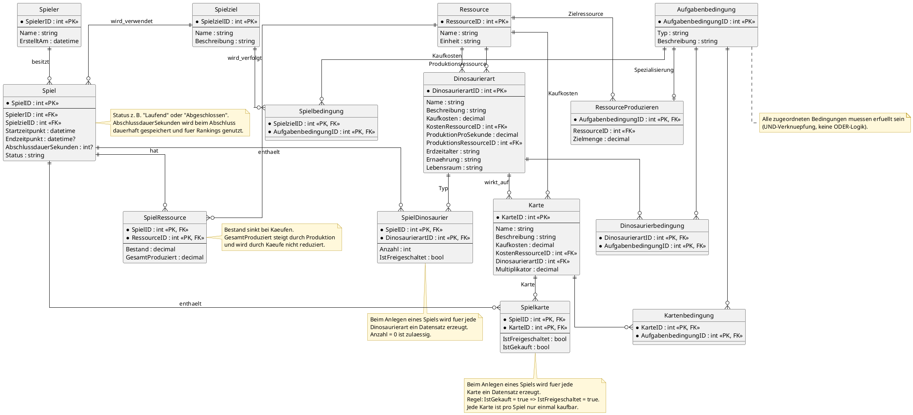

# ER-Modell – Dinosauria

## Modellierungsnotizen

Die ER-Darstellung verwendet eine tabellenorientierte Notation mit Kardinalitäten (Crow’s Foot), keine Chen-Notation.

### Enumerationen

Die folgenden Attribute der Entität `Dinosaurierart` werden als Enumerationen modelliert und deshalb nicht als separate Entitäten dargestellt:

| Attribut | Enumeration | Zulässige Werte |
|---|---|---|
| `Erdzeitalter` | `Erdzeitalter` | `Trias`, `Jura`, `Kreide` |
| `Ernaehrung` | `Ernaehrung` | `Pflanzenfresser`, `Fleischfresser`, `Allesfresser` |
| `Lebensraum` | `Lebensraum` | `Land`, `Wasser`, `Luft` |

### Zentrale Modellentscheidungen

- `SpielRessource` speichert den aktuellen Bestand (`Bestand`) und die insgesamt produzierte Menge (`GesamtProduziert`) getrennt.
- `SpielDinosaurier` enthält pro Spiel und Dinosaurierart genau einen Datensatz. Der zusammengesetzte Primärschlüssel besteht aus `SpielID` und `DinosaurierartID`. `Anzahl` speichert die gekaufte Anzahl; `IstFreigeschaltet` speichert den Freischaltungsstatus.
- `Spielkarte` enthält pro Spiel und Karte genau einen Datensatz. Der zusammengesetzte Primärschlüssel besteht aus `SpielID` und `KarteID`. `IstFreigeschaltet` und `IstGekauft` speichern den Zustand der Karte. Eine Karte kann pro Spiel nur einmal gekauft werden.
- `Aufgabenbedingung` ist die gemeinsame abstrakte Grundlage für konkrete Bedingungstypen. `RessourceProduzieren` ist ein konkreter Bedingungstyp.
- `Spielbedingung`, `Dinosaurierbedingung` und `Kartenbedingung` verbinden Bedingungen mit Spielzielen, Dinosaurierarten beziehungsweise Karten. Alle zugeordneten Bedingungen müssen erfüllt sein (UND-Verknüpfung).
- Ein Spiel wird mit Datensätzen für alle Dinosaurierarten und alle Karten initialisiert. Der Freischaltungsstatus wird je Spiel gespeichert.
- Die Abschlussdauer wird für abgeschlossene Spiele gespeichert. Die globale Rangliste verwendet pro Spieler die beste Abschlusszeit; unvollständige Spiele werden nicht gewertet.

## Entitäten und wichtige Attribute

- **Spieler**: `SpielerID` (PK), `Name`
- **Spiel**: `SpielID` (PK), `SpielerID` (FK), `Startzeitpunkt`, `Endzeitpunkt`, `AbschlussdauerSekunden`, `Status`
- **Spielziel**: `SpielzielID` (PK), `SpielID` (FK), `Bezeichnung`
- **Ressource**: `RessourceID` (PK), `Name`
- **SpielRessource**: `SpielID` (PK, FK), `RessourceID` (PK, FK), `Bestand`, `GesamtProduziert`
- **Dinosaurierart**: `DinosaurierartID` (PK), `Name`, `Beschreibung`, `Kaufkosten`, `KaufressourceID` (FK), `ProduktionProSekunde`, `ProduktionsressourceID` (FK), `Erdzeitalter`, `Ernaehrung`, `Lebensraum`
- **SpielDinosaurier**: `SpielID` (PK, FK), `DinosaurierartID` (PK, FK), `Anzahl`, `IstFreigeschaltet`
- **Karte**: `KarteID` (PK), `Name`, `Beschreibung`, `Kaufkosten`, `KaufressourceID` (FK), `Multiplikator`, `DinosaurierartID` (FK)
- **Spielkarte**: `SpielID` (PK, FK), `KarteID` (PK, FK), `IstFreigeschaltet`, `IstGekauft`
- **Aufgabenbedingung**: `AufgabenbedingungID` (PK), `Bezeichnung`
- **RessourceProduzieren**: `AufgabenbedingungID` (PK, FK), `RessourceID` (FK), `Zielmenge`
- **Spielbedingung**: `SpielzielID` (PK, FK), `AufgabenbedingungID` (PK, FK)
- **Dinosaurierbedingung**: `DinosaurierartID` (PK, FK), `AufgabenbedingungID` (PK, FK)
- **Kartenbedingung**: `KarteID` (PK, FK), `AufgabenbedingungID` (PK, FK)

## Hinweis

Die genaue Umsetzung der Enumerationen in der Datenbank hängt von der EF-Core-Konfiguration ab. Ohne besondere Konfiguration speichert EF Core Enum-Werte standardmäßig als Ganzzahlen (`int`).

## PlantUML-Quelltext

Der folgende Quelltext erzeugt das ER-Modell. Er kann in eine `.puml`-Datei kopiert oder direkt in PlantUML verwendet werden.

