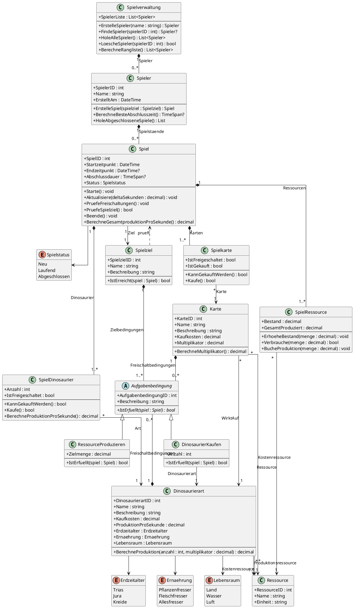

# Dinosauria – UML-Klassendiagramm der Domänenlogik

## 1. Ziel und Umfang

Dieses Klassendiagramm beschreibt die Domänenlogik des Spiels Dinosauria. WPF-Oberflächen, EF-Core-Konfigurationen, Repository-Klassen und andere Infrastrukturdetails sind bewusst nicht enthalten.

Die Darstellung verwendet UML-Klassen mit Attributen, Methoden, Vererbung, Assoziationen und Kardinalitäten.

## 2. Bedingungen

`Aufgabenbedingung` ist die abstrakte Basisklasse für Bedingungen, die Spielziele und Freischaltungen beschreiben. Sie definiert die gemeinsame Eigenschaft `Beschreibung` und die abstrakte Methode `IstErfuellt(spiel : Spiel)`.

Die konkreten Bedingungstypen sind:

- **`RessourceProduzieren`**: erfüllt, wenn im Spiel mindestens die angegebene Gesamtmenge einer bestimmten Ressource produziert wurde. Dafür wird die kumulierte Produktion (`GesamtProduziert`) geprüft, nicht der aktuelle Bestand.
- **`DinosaurierKaufen`**: erfüllt, wenn im Spiel mindestens die angegebene Anzahl einer bestimmten Dinosaurierart gekauft wurde. Bei `Anzahl = 1` bedeutet das: mindestens ein Exemplar dieser Art muss gekauft worden sein. Die Dinosaurierart wird über die Assoziation `Dinosaurierart` referenziert.

Alle Bedingungen, die einem Ziel oder einem Freischaltungsobjekt zugeordnet sind, müssen erfüllt sein (UND-Verknüpfung).

## 3. Zentrale Modellierungsentscheidungen

- `Dinosaurierart`, `Karte` und `Ressource` sind Katalogklassen.
- `SpielRessource`, `SpielDinosaurier` und `Spielkarte` speichern den jeweiligen Zustand innerhalb einer konkreten Spielpartie.
- `SpielRessource` unterscheidet zwischen aktuellem `Bestand` und kumuliertem `GesamtProduziert`.
- `SpielDinosaurier` speichert die gekaufte Anzahl und den Freischaltungsstatus einer Dinosaurierart in einem Spiel.
- `Spielkarte` speichert Freischaltungs- und Kaufstatus. Eine Karte kann pro Spiel nur einmal gekauft werden.
- `Spiel` verwaltet den Spielablauf, die Produktion, die Prüfung von Freischaltungen und das Erreichen des Spielziels.
- Die Enum-Typen `Erdzeitalter`, `Ernaehrung`, `Lebensraum` und `Spielstatus` beschränken die jeweiligen Werte auf festgelegte Auswahlmöglichkeiten.

## 4. Identifikatoren

Die Katalog- und Hauptklassen besitzen eigene IDs. Für die spielbezogenen Zustandsklassen bleibt die ER-Modellierung mit zusammengesetzten Schlüsseln maßgeblich:

- `SpielRessource`: `SpielID` + `RessourceID`
- `SpielDinosaurier`: `SpielID` + `DinosaurierartID`
- `Spielkarte`: `SpielID` + `KarteID`

Diese zusammengesetzten Schlüssel werden nicht als zusätzliche fachliche Attribute aufgeführt, weil die Zugehörigkeit durch die Assoziationen dargestellt wird.

## 5. Vollständiger PlantUML-Quellcode

Der folgende Code kann als Datei mit der Endung `.puml` gespeichert und mit einer PlantUML-Erweiterung gerendert werden.

