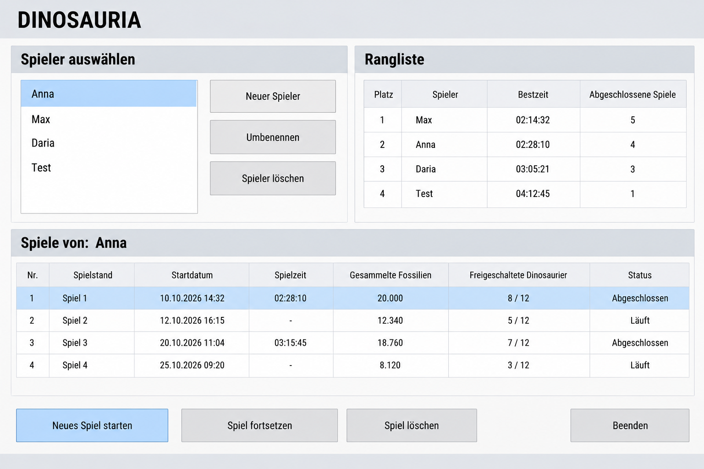
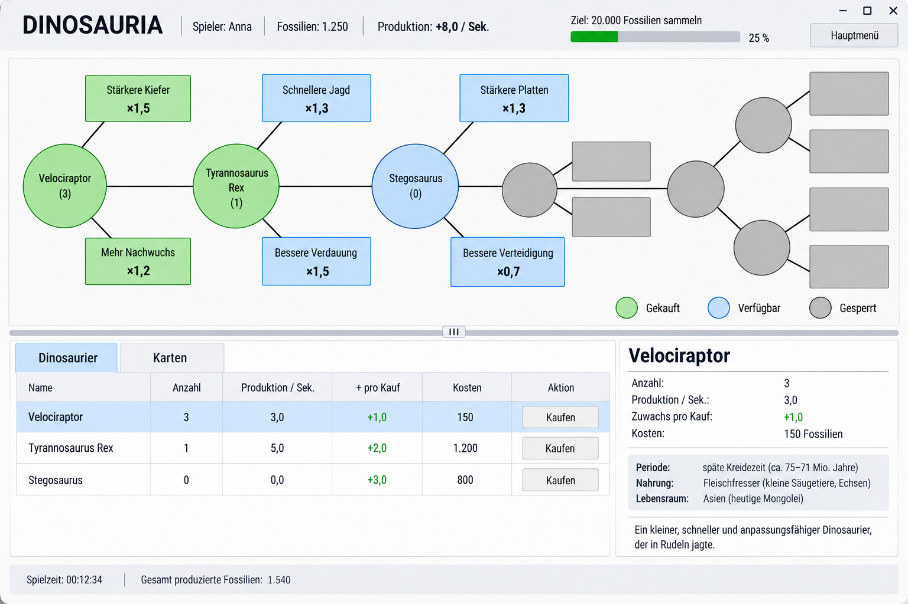
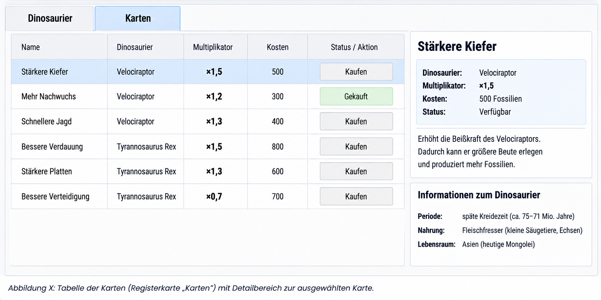

# Dinosauria
## Wireframe-Entwurf der Benutzeroberfläche

**Entwurf für die erste Version – 29.10.2026**

## 1. Ziel des Wireframes

Der Wireframe stellt die geplante Anordnung der wichtigsten Elemente der Benutzeroberfläche des Spiels Dinosauria dar. Er dient als Grundlage für die spätere Umsetzung mit WPF und XAML. Der Fokus liegt auf einer einfachen, übersichtlichen Oberfläche ohne aufwendige Gestaltung.

## 2. Hauptmenü

Im Hauptmenü kann ein Spieler ausgewählt oder neu angelegt werden. Außerdem werden die globale Rangliste und die gespeicherten Spiele des ausgewählten Spielers angezeigt.

*Abbildung 1: Wireframe des Hauptmenüs*

### 2.1 Spieler auswählen und verwalten

- Eine Liste zeigt alle vorhandenen Spieler.
- Über **„Neuer Spieler“** kann ein neuer Spieler angelegt werden.
- **„Umbenennen“** ändert den Namen des ausgewählten Spielers.
- **„Spieler löschen“** entfernt den ausgewählten Spieler nach einer Bestätigung einschließlich seiner gespeicherten Spiele.

### 2.2 Rangliste

Die globale Rangliste zeigt pro Spieler die beste Abschlusszeit und die Anzahl der abgeschlossenen Spiele. Maßgeblich ist die kürzeste Zeit, in der der Spieler das Spielziel erreicht hat. Spieler ohne abgeschlossene Spiele werden nicht in die Rangliste aufgenommen.

### 2.3 Spiele des ausgewählten Spielers

Die Tabelle zeigt die gespeicherten Spiele des oben ausgewählten Spielers. Angezeigt werden Spielnummer, Startdatum, Spielzeit, Gesamtproduktion der Fossilien, freigeschaltete Dinosaurier und Status. Laufende Spiele können fortgesetzt werden; abgeschlossene Spiele dienen der Ergebnisansicht.

Die Schaltflächen im unteren Bereich ermöglichen das Starten eines neuen Spiels, das Fortsetzen des ausgewählten laufenden Spiels, das Löschen eines ausgewählten Spielstands und das Beenden der Anwendung.

## 3. Spielübersicht

Die Spielübersicht besteht aus einer Kopfzeile, dem Spielziel, dem Spielfeld, der Dinosaurier-Tabelle und einer Statuszeile. Eine linke Seitenleiste ist nicht vorgesehen; weitere Funktionen sind über das Hauptmenü erreichbar.

*Abbildung 2: Wireframe der Spielübersicht*

### 3.1 Kopfzeile und Spielziel

- Die Kopfzeile zeigt den Spielnamen, den Spielernamen, den aktuellen Fossilienbestand und die Produktion pro Sekunde.
- Das Spielziel und der Fortschritt werden im oberen Bereich angezeigt.
- Die Schaltfläche **„Hauptmenü“** führt zurück zum Hauptmenü.

### 3.2 Spielfeld

- Das Spielfeld ist eine gemeinsame, bei Bedarf scrollbar ausgeführte Fläche.
- Dinosaurier werden als Kreise und Karten als Rechtecke dargestellt. Es werden zunächst nur einfache geometrische Formen, Text und gerade Verbindungslinien verwendet.
- Jede Karte ist genau einer Dinosaurierart zugeordnet und wird durch eine direkte Linie mit dem zugehörigen Dinosaurier-Kreis verbunden. Karten sind keine Zwischenknoten und werden nicht miteinander verbunden.
- Gekaufte Dinosaurier und Karten werden grün dargestellt.
- Freigeschaltete, aber noch nicht gekaufte Elemente werden blau und optisch zurückhaltend dargestellt.
- Gesperrte Elemente werden grau und ohne Namen oder weitere Informationen angezeigt.

### 3.3 Dinosaurier-Tabelle

Unterhalb des Spielfelds befindet sich eine Tabelle mit allen freigeschalteten Dinosaurierarten, die bereits gekauft wurden oder zum Kauf verfügbar sind. Gesperrte Arten werden nicht angezeigt.

Die Tabelle enthält folgende Spalten: **Name**, **Anzahl**, **Produktion pro Sekunde**, **Produktionszuwachs beim Kauf eines weiteren Exemplars**, **Kosten des nächsten Exemplars** und die Schaltfläche **„Kaufen“**.

Die angezeigte Produktion berücksichtigt bereits alle aktiven Kartenmultiplikatoren. Bei einer freigeschalteten, aber noch nicht gekauften Dinosaurierart beträgt die aktuelle Produktion null. Der angezeigte Produktionszuwachs berücksichtigt ebenfalls die aktiven Kartenmultiplikatoren. Der Preis jedes weiteren Exemplars steigt um 15 % gegenüber dem Preis des vorherigen Exemplars.

Rechts neben der Tabelle befindet sich ein Detailbereich, in dem zusätzliche Informationen zum ausgewählten Dinosaurier angezeigt werden: Name, Anzahl, Produktion pro Sekunde, Produktionszuwachs beim Kauf, Kosten des nächsten Exemplars sowie Erdzeitalter, Ernährung, Lebensraum und eine kurze Beschreibung.

### 3.4 Kartentabelle

*Abbildung 3: Tabelle der Karten*

Die Kartentabelle befindet sich im unteren Bereich des Spielfensters auf der Registerkarte **„Karten“**. Sie wird unabhängig vom Spielfeld dargestellt und ermöglicht den Kauf freigeschalteter Karten. Gesperrte Karten werden in der Tabelle nicht angezeigt.

Die Tabelle enthält folgende Spalten: **Name**, **zugehörige Dinosaurierart**, **Multiplikator**, **Kosten** und **Aktion**. Bereits gekaufte Karten sind entsprechend gekennzeichnet und können nicht erneut gekauft werden. Für verfügbare Karten wird die Schaltfläche **„Kaufen“** angezeigt. Ist das Fossilienguthaben nicht ausreichend, ist die Kaufaktion nicht verfügbar.

Rechts neben der Tabelle befindet sich ein Detailbereich für die ausgewählte Karte. Er zeigt den Namen, die zugehörige Dinosaurierart, den Multiplikator, die Kosten, den Freischaltungs- bzw. Kaufstatus und eine kurze Beschreibung an. Zusätzlich werden Informationen zur zugehörigen Dinosaurierart angezeigt: Erdzeitalter, Ernährung und Lebensraum.

Nach dem Kauf einer Karte werden ihr Status im Spielfeld, die Produktion der zugehörigen Dinosaurierart und die Gesamtproduktion automatisch aktualisiert.

### 3.5 Statuszeile

Am unteren Rand werden die bisherige Spielzeit und die insgesamt produzierten Fossilien angezeigt. Die Gesamtproduktion ist ein kumulierter Wert und wird durch Käufe nicht reduziert.

## 4. Hinweise zur Umsetzung

Die Abbildungen sind schematische Entwürfe. Beispielnamen, Zahlenwerte und Spielstände dienen nur der Veranschaulichung und sind keine verbindlichen Spieldaten. Die endgültigen Abstände und Größen werden bei der Umsetzung in WPF angepasst.

