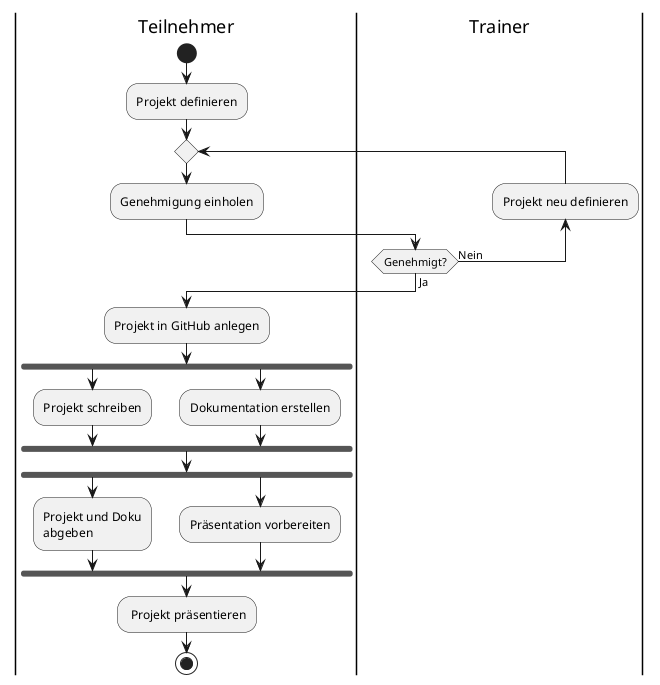

# WPF-Projektwoche

In der **Projektwoche** (ab Freitag) haben Sie die Gelegenheit, die in den letzten Wochen erworbenen Kenntnisse in den Bereichen Programmiergrundlagen, OOP und **WPF** praktisch anzuwenden und zu vertiefen.

Das Hauptziel ist die **selbstständige Entwicklung** eines kleinen Softwareprojekts – von der Konzeption bis hin zur Implementierung einer grafischen Benutzeroberfläche (GUI).

---

## Der Projektauftrag

Wählen Sie bitte ein Thema aus, das Ihr Interesse weckt (eine Liste möglicher Themen finden Sie weiter unten), oder nutzen Sie Ihr bisheriges **Grundlagenprojekt** aus den Softwaregrundlagen, um dieses zu erweitern und mit einer **GUI-Schicht** zu versehen. Auch die Erweiterung eines der vorliegenden Mini-Projekte ist denkbar. 

Ihr Projekt sollte die folgenden Hauptbestandteile umfassen:

1. **Domänenmodell:**
   * Entwickeln Sie ein **eigenes Domänenmodell** für Ihr gewähltes Thema.
   * Visualisieren Sie dieses Modell in einem **Entity-Relationship-Diagramm** bzw. **Klassendiagramm** (oder anderen relevanten UML-Diagrammen, falls sinnvoll).

2. **Präsentationsschicht (GUI):**
   * Implementieren Sie eine **grafische Benutzeroberfläche (GUI)** unter Verwendung von **WPF (Windows Presentation Foundation)**. Hierbei liegt ein besonderer Fokus auf der praktischen Umsetzung. 
   * Dokumentieren Sie Ihren Entwurf in einem Wireframe und stellen Sie diesem einen Screenshot Ihrer fertigen Anwendung gegenüber (Entwurf vs. finale Umsetzung).
   * Die GUI muss eine **interaktive Nutzung** Ihres Domänenmodells ermöglichen. 
   * ***Für Fortgeschrittene bzw. als Erweiterungsoption:*** Nutzen Sie das **MVVM-Muster** (Model-View-ViewModel), um die Präsentationsschicht strukturiert und wartbar zu gestalten.

3. **Datenpersistenz (Optional / Erweiterung):**
   * ***Optional:*** Falls für Ihr Projekt sinnvoll, können Sie eine **Persistenzschicht** integrieren, um Daten dauerhaft zu speichern und zu laden (z. B. über einfache **CSV-** bzw. **XML-Dateien** oder per SQL über das **Entity Framework**). 

> Natürlich können Sie sich im Rahmen dieser Woche auch neues Know-how aneignen, insbesondere über *LinkedIn-Learning*-Kurse zu Themen wie `LINQ`, dem `Entity Framework` o. Ä. 

---

## Zeitplan und Abgabe

| Tag | Aufgabe | Fälligkeit / Deadline |
| :--- | :--- | :--- |
| **Freitag** | **Mitteilung der Projektidee** | Bis spätestens **Freitag** teilen Sie mir Ihr gewähltes Projektthema mit. |
| **(Über)nächste Woche (?)** | **Abschluss des Projekts** | Bereitstellung des fertigen Projekts auf GitHub. |
| **(Über)nächste Woche (?)** | **Kurzpräsentation** | Am **letzten Tag** stellen Sie Ihr Projekt der Gruppe in ca. 5 bis 7 Minuten vor. Präsentieren Sie die Funktionalität und erläutern Sie kurz Ihre Architektur (Domänenmodell und GUI-Ansatz). |

---

## Rahmenbedingungen

* Im Rahmen des Projekts findet täglich ein kurzes **Stand-up-Meeting** statt. Dabei berichtet jeder Teilnehmer über die Arbeit des Vortags, benennt aktuelle Probleme oder Hindernisse und stellt den Plan für den aktuellen Tag vor.  
* Das Projekt wird auf **GitHub** veröffentlicht. Der entsprechende Link zum Repository wird dem Trainer zur Verfügung gestellt. Bitte zuästzlich Lösung als ZIP-Archiv mit dem gewohnten Namensschema (`Nachname-Vorname-WPF-Abschlussprojekt.zip`) einreichen.

---

## Ablauf

## 10 mögliche Projektthemen

Diese Liste dient als Inspiration; Sie können alternativ auch ein eigenes, vergleichbar komplexes Thema wählen:

1. **Adress- oder Kontaktverwaltung** (Anlegen, Ändern und Suchen von Personen mit Details wie Name, Telefonnummer und E-Mail).
2. **To-Do-Liste** (Hinzufügen, Abhaken, Löschen und Priorisieren von Aufgaben).
3. **Bibliotheksverwaltung** (Verwaltung von Büchern und deren Ausleihstatus).
4. **Warenkorb-Simulation** (Hinzufügen und Entfernen von Artikeln sowie Anzeige der Gesamtsumme).
5. **Rechnungs- oder Belegsammlung** (Speichern von Rechnungsbeträgen und -daten inklusive einfacher Auswertungen).
6. **Kochrezept-Sammlung** (Verwaltung von Rezepten mit Zutatenliste und Zubereitungsschritten).
7. **Kleines Quiz-Programm** (Anzeigen von Fragen und Antworten sowie Zählen der erreichten Punktzahl).
8. **Vokabeltrainer** (Verwaltung von ein oder zwei Feldern zur Vokabelabfrage und Speicherung des Lernerfolgs).
9. **Fahrzeugflottenverwaltung** (Verwaltung von Autos inklusive Kennzeichen, Modell und Wartungsterminen).
10. **Tagebuch- oder Notizbuch-Anwendung** (Erstellen, Speichern und Anzeigen einfacher Textnotizen mit Datum).